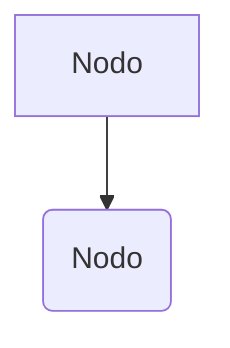

# CONTINUE.md — Ricerca Operativa I (Raven's Soul)

> Questo file viene caricato automaticamente da Continue nel contesto quando lavori su questo repository.
> Serve come guida per te e (eventuali) collaboratori per capire struttura, convenzioni e workflow del progetto.

---

## 1. Panoramica del Progetto

**Nome:** Ricerca-Operativa
**Tipo:** Repository di appunti e materiale didattico personale (non un progetto software).
**Scopo:** Rielaborare, sintetizzare e schematizzare i contenuti del corso universitario di **Ricerca Operativa I**, con focus su formulazione e soluzione di problemi di ottimizzazione.
**Autore:** Raven's Soul
**Licenza:** Tutti i diritti riservati (uso personale/studio, vietata ridistribuzione).

**Contenuti principali:**
- Appunti teorici organizzati per argomenti d'esame (Esonero I).
- Esercizi risolti di esame (formulazione di problemi di PL).
- Diagrammi Mermaid, formule LaTeX, callout Obsidian.

---

## 2. Struttura delle Cartelle

```
Ricerca-Operativa/
├── README.md                          ← Indice principale con link e sommario
├── LICENSE                            ← Dichiarazione di proprietà e divieti
├── Es/                                ← Esercizi d'esame risolti
│   └── Formulazione.md                ← 3 esercizi di formulazione PL (esami vari)
├── Esonero I/                         ← Appunti teorici del primo esonero
│   ├── Introduzione alla Ricerca Operativa.md
│   ├── Formulazione di tipici problemi di ottimizzazione.md
│   ├── Soluzione di problemi di Programmazione Lineare.md
│   ├── Ottimizzazione su grafi.md     ← (ancora da completare)
│   └── Teoria della dualità.md        ← (ancora da completare)
└── .continue/
    └── rules/
        └── CONTINUE.md                ← Questo file
```

### Nota sul naming
- La cartella `Es/` è condivisa tra più esoneri (contiene esercizi di varie prove).
- `Esonero I/` corrisponde al **primo esonero scritto** del corso.
- Se aggiungerai un secondo esonero, crea una cartella `Esonero II/` con la stessa convenzione.

---

## 3. Convenzioni di Formattazione

I file sono scritti in **Markdown ottimizzato per Obsidian** (o editor compatibili con callout e LaTeX renderizzato). Ecco le regole da seguire:

### 3.1 Callout Obsidian
```markdown
>[!Note]
>Contenuto informativo.

>[!tip]
>Suggerimenti pratici, trappole da evitare, trucchi d'esame.

>[!CAUTION]
>Attenzione a casi limite o errori comuni.

>[!Important]
>Definizioni chiave, teoremi fondamentali.
```

### 3.2 Formule LaTeX
- **Display math:** `$$ ... $$` (su riga propria)
- **Inline math:** `$ ... $`
- **Ambienti LaTeX usati:** `\begin{gather}`, `\begin{cases}`, `\begin{matrix}`, `\begin{align*}`, `\left(\begin{matrix}...\end{matrix}\right)`, `\begin{Bmatrix}`
- **Nota di escaping:** Nei blocchi `$$`, usa `\\{` e `\\}` per graffe, oppure `\{` e `\}` (verifica la resa nell'editor).

### 3.3 Diagrammi Mermaid
```markdown

```
I diagrammi sono avvolti in `<details><summary>` per renderli collassabili.

### 3.4 Link interni e note a piè di pagina
- Link: `[Testo](Cartella/File%20con%20spazi.md)` (spazi codificati come `%20`).
- Piè di pagina: `[^1]` con definizione alla fine del file.
- Callout con contenuti collassabili: annidati dentro `<details><summary>...</summary>...</details>`.

### 3.5 Simboli matematici e convenzioni d'uso
- Vettore colonna: `x = \left(\begin{matrix}x_1\\x_2\\\vdots\\x_n\end{matrix}\right)`
- Matrice: `A \in \mathbb{R}^{m \times n}`
- Vincoli: `Ax \leq b`, variabili: `x \in \mathbb{R}^n`
- Variabili con doppio indice: `x_{ij}` (origine → destinazione)

---

## 4. Argomenti Coperti (stato di avanzamento)

| # | Argomento | Stato | Note |
|---|-----------|-------|------|
| 1 | Introduzione alla RO (metodo delle 5 fasi, modello matematico, metodo grafico, notazione vettoriale/matrice) | ✅ Completo | Con diagramma Mermaid |
| 2 | Formulazione di tipici problemi (Miscelazione, Allocazione, Scorte, Assegnazione, Pianificazione, Trasporto, Taglio ottimo) | ✅ Completo | Con esempi e trappole |
| 3 | Soluzione di problemi di PL (Fourier-Motzkin, geometria della PL) | ⚠️ Parziale | Il simplesso non è ancora presente |
| 4 | Ottimizzazione su grafi (flusso massimo, cammino minimo, albero ricoprente) | ❌ Da scrivere | File vuoto |
| 5 | Teoria della dualità (duale, teorema fondamentale, complementarità, sensitività) | ❌ Da scrivere | File vuoto |

---

## 5. Workflow di Studio e Aggiunta Contenuti

### 5.1 Aggiungere un nuovo argomento
1. Crea il file nella cartella giusta (es. `Esonero I/Ottimizzazione su grafi.md`).
2. Inizia con un titolo `#` corrispondente a quello nell'indice del README.
3. Aggiungi sotto-titoli `##` e `###` per sottoargomenti.
4. Usa callout per definizioni (`[!Important]`), trappole (`[!tip]`), errori comuni (`[!CAUTION]`).
5. Inserisci formule LaTeX e diagrammi Mermaid.
6. Aggiorna il link nel `README.md` se il file non esiste già nella lista.

### 5.2 Aggiungere un esercizio d'esame
1. Apri (o crea) il file in `Es/` (es. `Es/Ottimizzazione_su_grafi.md`).
2. Formato standard:
   - Callout `[!NOTE]` con intestazione: `### Esonero X del gg/mm` oppure `### Esame_MeseAnno_Sezione`
   - Testo del problema fedelmente copiato.
   - Sezione `Variabili di Decisione` → `Funzione Obiettivo` → `Vincoli` → `Vincoli di Non Negatività`
   - Eventuali note sulle "Trappole" con callout `[!tip]`.

### 5.3 Aggiornare l'indice nel README
- Il README usa un blocco `>[!tip]` con `<details>` per listare gli argomenti in modo collassabile.
- Segui la numerazione `1.` ripetuta (Markdown la riscrive automaticamente).
- Per nuovi esercizi, aggiungi un link `[Es](./Es/NuovoFile.md)` sotto l'argomento corrispondente.

### 5.4 Estrarre concetti da PDF di lezioni/slide (workflow OCR)
- I PDF di lezione (es. export OneNote) spesso sono **solo immagini**: il testo estratto è inutile, serve OCR.
- Tooling usato (solo pip, niente installer esterni): `pypdf` per titoli/testo nativo, `pypdfium2` per renderizzare pagine, `rapidocr-onnxruntime` per OCR in italiano.
- Procedura:
  1. estrarre i **titoli delle sezioni** (testo nativo OneNote) per localizzare gli argomenti ed escludere le slide di esercizio;
  2. renderizzare + OCR **solo le pagine di teoria** (scale 2.0–2.5);
  3. riscrivere i **concetti chiave** nello stile del repo.
- ⚠️ **Non copiare** testi/formule dalle slide del docente (sono materiale loro) e **non ricopiare gli esercizi**: rielaborare e basta.
- ⚠️ I file temporanei (`_tmp_*`) e i PDF (`*.pdf`) sono nel `.gitignore`: **non devono finire nei commit**.

---

## 6. Convenzioni Matematiche del Corso

Per coerenza con le fonti originali del corso:

- **Formulazione:** `\min c^T x` soggetto a `Ax \leq b`, `x \geq 0`.
- **Variabili:** sono definite SEMPRE prima di vincoli e funzione obiettivo.
- **Vincoli di interezza:** se richiesto, si scrive esplicitamente `x_i \in \mathbb{Z}` (problemi di taglio, assegnazione).
- **Equazione di bilancio per scorte:** `m_t = m_{t-1} + x_t - d_t` (NON usare `≤` o `≥`).
- **Vincoli di copertura** (turnazioni/pianificazione attività): usare `≥`.
- **Vincoli di trasporto/assegnazione:** uguaglianza `=` per la domanda, `≤` per la capacità delle origini.

---

## 7. Common Tasks (ricerca rapida)

| Cosa devi fare | Dove cercare |
|----------------|--------------|
| Formulaire un problema dal testo | `Esonero I/Formulazione di tipici problemi...md` + `Es/Formulazione.md` |
| Capire il metodo grafico 2D | `Esonero I/Introduzione...md` → sezione "Metodo Grafico" |
| Risolvere una PL senza simplesso | `Esonero I/Soluzione...md` → Fourier-Motzkin |
| Costruire il duale di un problema | `Esonero I/Teoria della dualità.md` (⚠️ ancora vuoto) |
| Flusso massimo / cammino minimo | `Esonero I/Ottimizzazione su grafi.md` (⚠️ ancora vuoto) |
| Trappole tipiche d'esame | Callout `[!tip]` e `[!CAUTION]` sparsi nei file |

---

## 8. Troubleshooting

- **LaTeX non renderizzato:** verifica di usare un editor/estensione che supporti MathJax o KaTeX (Obsidian di default lo fa; VS Code richiede l'estensione *Markdown Preview Enhanced* o *Markdown All in One* + MathJax).
- **Spazi nei link rotti:** codifica sempre gli spazi come `%20` nei link relativi (`Esonero%20I/File.md`).
- **Mermaid non renderizzato:** assicurati che il blocco sia chiuso con `` ``` `` su riga propria, senza spazi alla fine.
- **Callout con contenuto a più livelli:** il `>` deve precedere OGNI riga del callout, comprese le righe vuote interne.

---

## 9. Fonti e Riferimenti

- **Fonti originali del corso:** materiale del docente (slide, dispense) — *non presenti nel repo per questione di copyright*; sono citati genericamente nel README con nota `[^1]`.
- **Calcolatore PL usato:** **IBM CPLEX** — per verificare soluzioni ottime dei problemi formulati.
- **Propedeuticità dichiarate:** Geometria e Combinatoria.

> ⚠️ Le fonti di questi appunti sono rielaborazioni personali + contributi di colleghi + supporto di IA. Potrebbero contenere errori: verificare sempre con il materiale ufficiale del corso.

---

## 10. Regole Specifiche per Continue (prompt hints)

Quando mi chiedi di modificare o aggiungere contenuti a questo repo:

1. **Mantieni lo stile Obsidian** (`>[!Tip]`, `>[!Note]`, etc.).
2. **Non modificare** LICENSE o README senza motivo esplicito.
3. Se aggiungi formule, **spiega sempre la variabile di decisione** prima di scrivere i vincoli.
4. Se risolvi un esercizio, **indica esplicitamente** a quale "tipo tipico" appartiene (Miscelazione, Trasporto, Taglio, ...).
5. Rispondi in **italiano**, come il resto del materiale.
6. Quando un argomento è incompleto (es. Ottimizzazione su grafi), suggerisci una scaletta di sotto-argomenti prima di riempire il contenuto.

---

## 11. Note per Regole Annidate

Se in futuro creerai sotto-cartelle (es. `Esonero II/`, `Laboratorio/`), puoi aggiungere un file `.continue/rules/CONTINUE.md` in quella sottocartella per regole più specifiche (es. convenzioni per il linguaggio di modellazione usato in laboratorio). Continue li caricherà in aggiunta a questo file principale.

---

*Creato automaticamente per supportare il flusso di studio con Continue. Rivedi, integra e correggi in base a ciò che hai studiato.*